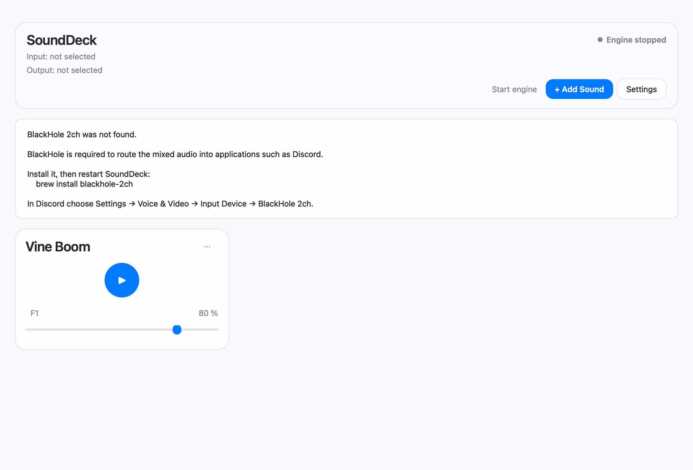

# SoundDeck

SoundDeck is a desktop soundboard for Discord and other voice chats. It records your microphone, mixes in sound effects, and sends the result to a virtual audio device. Discord uses that device as its microphone.

The first version is a macOS app with a Liquid Glass inspired interface. The audio core, library, hotkeys, and configuration do not depend on macOS, so a Windows build can later use VB-CABLE and a Fluent theme without rewriting the mixer.



## Features

- Pick a physical microphone and a virtual output (BlackHole 2ch on macOS).
- Import MP3, WAV, M4A, FLAC, and OGG. Files are decoded once, not on every key press.
- Play several sounds at once, mixed with the microphone, with per-sound volume.
- Assign global hotkeys that work when the app is in the background.
- Cut a YouTube clip you are allowed to use, preview it, and keep only the clip.
- First-run setup for the microphone, the virtual device, and Discord.

## Architecture

```
UI cards and dialogs
        │
        ▼
SoundboardController
        ├── AudioEngine + Mixer
        ├── HotkeyManager
        ├── SoundLibrary (JSON config)
        └── YouTube workers
                │
                ▼
        PlatformAdapter (macOS now, Windows stub)
```

```
Microphone → InputStream → ring buffer ─┐
Decoded sounds in memory ───────────────┼→ Mixer → soft clip → OutputStream → BlackHole → Discord
```

Details, including how PCM, the callback, and YouTube cutting work, are in [HOW_IT_WORKS.md](HOW_IT_WORKS.md) (Czech).

## Tech stack

- Python 3.12+
- PySide6
- sounddevice and NumPy
- FFmpeg (external)
- pynput
- yt-dlp
- PyObjC on macOS for optional window vibrancy

## Requirements

- macOS on Apple Silicon (the core is portable; the polished UI is the macOS theme)
- [BlackHole 2ch](https://github.com/ExistentialAudio/BlackHole)
- FFmpeg (`brew install ffmpeg`)
- Python 3.12 or newer

## Installation

```bash
python3 -m venv .venv
source .venv/bin/activate
pip install -e ".[dev,macos]"
```

## BlackHole setup

SoundDeck does not install an audio driver.

```bash
brew install blackhole-2ch
```

Restart SoundDeck and choose **BlackHole 2ch** as the virtual output. If it is missing, the app stays open and shows this same hint.

## Running the development version

```bash
source .venv/bin/activate
sounddeck
```

Config, decoded sounds, and logs are stored in `~/Library/Application Support/SoundDeck/`, not in the git checkout.

## Discord setup

1. Discord → Settings → Voice & Video → Input Device → **BlackHole 2ch**
2. Start the SoundDeck engine.
3. Speak, then trigger a sound. Discord should hear both.

Use headphones while testing. Sending the mix to real speakers while the microphone is live can feed back.

## Build a .app

PyInstaller is used instead of `pyside6-deploy` because the app ships PortAudio, pynput, and yt-dlp alongside Qt.

```bash
pip install -e ".[dev,macos]"
pyinstaller packaging/sounddeck.spec
```

The bundle is `dist/SoundDeck.app`. The spec sets `NSMicrophoneUsageDescription`. FFmpeg is still expected on the PATH. The first time macOS may ask for Microphone access and, for hotkeys, Accessibility access for the app or the terminal that launched it.

## Tests

```bash
pytest
```

Tests cover config, hotkeys, mixing, volume, clipping, playback position, file validation, timestamps, and YouTube clip rules. They do not open an audio device. The mixer is tested with NumPy arrays.

## Limitations

- Local monitoring of the mix is shown in Settings and disabled. A monitor can create a feedback loop and is not part of this version.
- The YouTube editor is a timeline with start and end controls. A waveform view can be added through `WaveformProvider`; the current provider draws nothing.
- One sound id plays one voice. Triggering it again restarts it. Different sounds overlap.
- A YouTube clip can be at most 120 seconds.
- The Windows theme and VB-CABLE hints exist, but native Mica/Acrylic and a Windows installer are not built yet.
- Global hotkeys need macOS Accessibility permission.

## Roadmap

- Windows 11 Fluent / Mica UI and a tested VB-CABLE path
- Local monitor with a feedback guard
- Waveform editor
- SQLite storage behind the existing `ConfigStorage` protocol
- Overlapping copies of the same sound

## Future Windows support

`src/soundboard/platform/windows.py` already returns an AppData directory and looks for VB-CABLE. `src/soundboard/ui/themes/windows/` supplies Fluent-oriented tokens. The sound cards, mixer, and controller stay the same. Nothing in the core checks `platform.system()` except `platform/detect.py`.

## License

[MIT](LICENSE)
